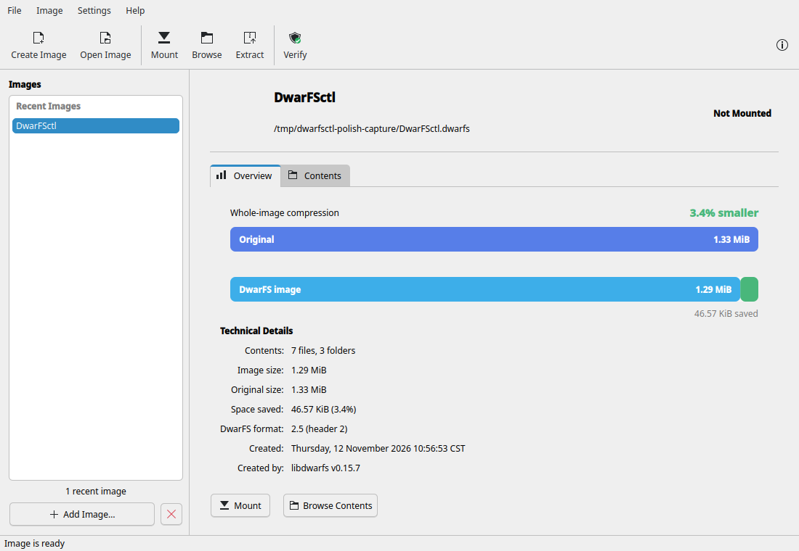
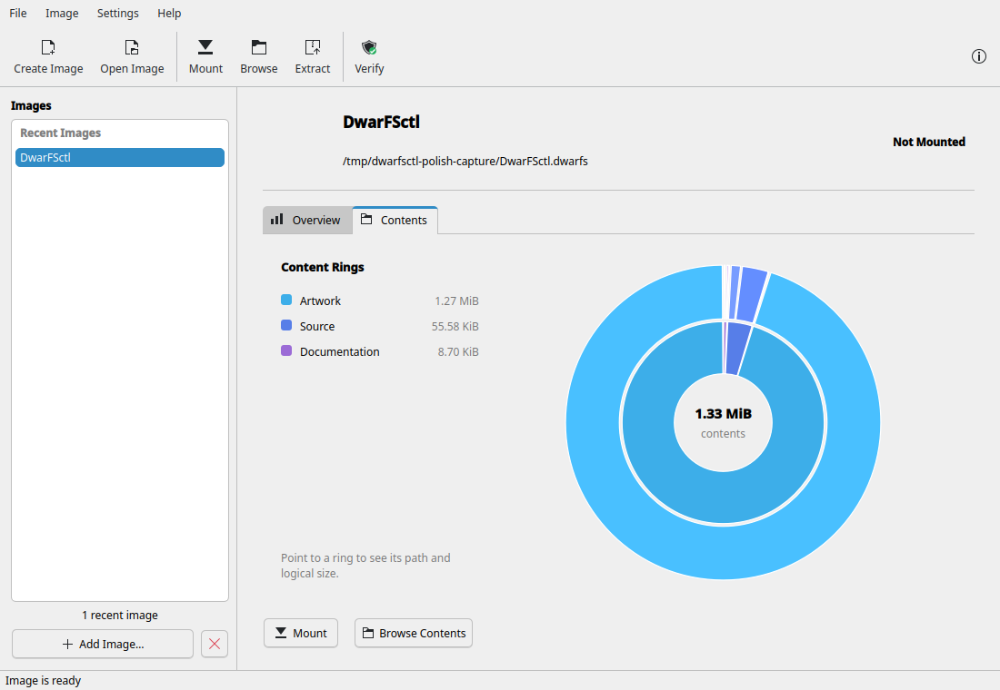

<p align="center">
  
</p>

<h1 align="center">DwarFSctl</h1>

<p align="center">DwarFS images, integrated with KDE Plasma and Dolphin.</p>

<p align="center">
  <a href="https://github.com/UglyEgg/dwarfsctl/actions/workflows/ci.yml"></a>
  <a href="https://www.opendesktop.org/p/2381869"></a>
</p>

DwarFSctl brings compressed filesystem images to the KDE desktop. Open **DwarFS
Utility**, the standalone app, to create images, inspect their contents, compare
compression, mount volumes and extract files. The Files view lets you browse
and select items to extract; Size Map shows what takes up space.

The same tools are available directly in Dolphin, with file previews, an image
Properties page and mounted volumes in Places. A Plasma tray application gives
you quick access to mounted images and shared settings.

The application ships the DwarFS engine it was tested with. Users do not need
to install DwarFS command-line tools or Rust.

Visit [dwfs.entropy.quest](https://dwfs.entropy.quest/) for the project overview,
everyday guide and downloads.

> DwarFSctl is an independent project. It is not affiliated with or endorsed by
> KDE or the DwarFS project.

## DwarFS Utility

Manage images in a standalone workspace, using the same engine and settings as
the Dolphin integration. Open **DwarFS Utility** from your application launcher.



Use **Files** to browse folders without mounting the image. Select files or
folders, then choose **Extract Selected…**. Choose **Extract All…** for the whole
image. Both actions create a new folder inside your chosen destination and keep
the original folder paths; existing folders are never overwritten.

Switch to **Size Map** to explore folders by size. Point to a ring to see its
path and contents.



Screenshots show DwarFSctl 0.13.1 with a sample image containing project
documentation, artwork and source files, rendered with KDE's Breeze style.
Version 0.14.0 adds Files and renames Contents to Size Map.

## Install

Downloads are covered by a GPG-signed checksum manifest. The Fedora RPMs also
carry package signatures.

Release packages target Fedora 45 on x86-64 and ARM64, plus Debian 13,
Ubuntu 26.04 and Arch Linux on x86-64.
Download the package for your distribution from the
[latest release](https://github.com/UglyEgg/dwarfsctl/releases/latest), then
install it with the distribution package manager:

```sh
# Fedora
sudo dnf install ./dwarfs-dolphin-*.rpm

# Debian or Ubuntu
sudo apt install ./dwarfs-dolphin_*.deb

# Arch Linux
sudo pacman -U ./dwarfs-dolphin-*.pkg.tar.zst
```

Log out and back in after the first installation so Plasma and Dolphin discover
every component. Package upgrades normally need only a Dolphin and tray restart.

## Use it

In Dolphin:

- Right-click a folder and choose **Build image → DwarFS**.
- Open a `.dwarfs` file to mount it and show the volume in Places.
- Browse an image without mounting it through its `dwarfs:` location.
- Open **Properties → DwarFS Image** for contents, compression and mount state.
- Use the file menu to extract, check integrity or work with checksums.
- Open tray **Settings…** to choose creation and mount behavior.

Open **DwarFS Utility** from the application launcher when you want to inspect
or manage several images in one place. Its Overview compares the original and
compressed sizes; Files supports browsing and selective extraction; Size Map
shows a bounded visual map of the image hierarchy.

Utility and the tray share recent-image history and its limit in Settings.
Turning history off keeps currently open images usable. Unavailable images stay
in the list with **Locate Image…**; **Show Image in Folder** reveals the source
file. Removing entries or clearing history never deletes images or unmounts
volumes.

Creation, extraction and checks show progress and elapsed time in their own
window. Cancel waits for cleanup before reporting cancellation; closing the
window requests cancellation and waits before closing. Mount operations show
their result but cannot be cancelled once dispatched.

The command-line interface exposes the same engine for scripts:

```sh
dwarfsctl build ./folder --output ./archive.dwarfs
dwarfsctl status ./archive.dwarfs
dwarfsctl mount ./archive.dwarfs
dwarfsctl extract ./archive.dwarfs ./restored
# Extract just one folder, keeping its archive-relative path:
dwarfsctl extract ./archive.dwarfs ./selected --path /Documents
dwarfsctl unmount ./archive.dwarfs
```

Run `man dwarfsctl` or `dwarfsctl COMMAND --help` for the version-matched command
reference.

### Verify a release

Release downloads include `SHA256SUMS` and its armored GPG signature,
`SHA256SUMS.asc`. Import [the repository's release key](RELEASE_SIGNING_KEY.asc)
and confirm its complete fingerprint before trusting the manifest:

```sh
gpg --import RELEASE_SIGNING_KEY.asc
gpg --fingerprint 60C38F37374C2B51BE7CA8CC698CE0575AED79AA
gpg --verify SHA256SUMS.asc SHA256SUMS
sha256sum --check --ignore-missing SHA256SUMS
```

Confirm your package appears in the checksum output with `OK`.

## What is included

- `dwarfsctl`, the public CLI and configuration service
- a private engine built from pinned DwarFS 0.15.10 source
- Dolphin file actions and a Properties page
- read-only `dwarfs:` browsing through KIO
- a Plasma tray application and D-Bus mount service
- DwarFS Utility, an optional standalone workspace with exact compression and
  bounded Content Rings views for managing several images
- MIME identification, icons and thumbnails for `.dwarfs` files

Images and mounted volumes are read-only. Extract files to a normal directory
before editing them. Browsing through `dwarfs:` does not show modification times;
mount the image when those timestamps matter.

## Build and contribute

The supported build uses Podman to create and test a native package for one of
the target distributions:

```sh
./packaging/container-build.sh fedora   # or debian, ubuntu, arch
```

See [CONTRIBUTING.md](CONTRIBUTING.md) for the architecture, development build,
tests and contribution expectations. The stable mount-service interface is
documented in [docs/DBUS_API.md](docs/DBUS_API.md).

## Security and licensing

Report vulnerabilities through GitHub's private
[security advisory form](https://github.com/UglyEgg/dwarfsctl/security/advisories/new).

DwarFSctl is licensed under GPL-3.0-or-later. Packages include the corresponding
application and pinned DwarFS source, along with third-party notices. See
[LICENSE](LICENSE) and [THIRD_PARTY_NOTICES.md](THIRD_PARTY_NOTICES.md).

## Use of AI

I lead the engineering work on DwarFSctl and make the design and release
decisions. I use AI coding assistants to help write and review code, develop
tests, and draft documentation. I decide what ships and take responsibility for
each release.

Copyright © 2026 Richard Majewski · Varanid Works.
